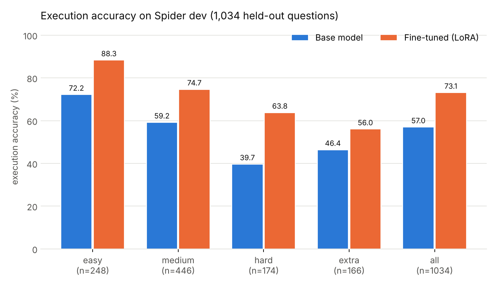
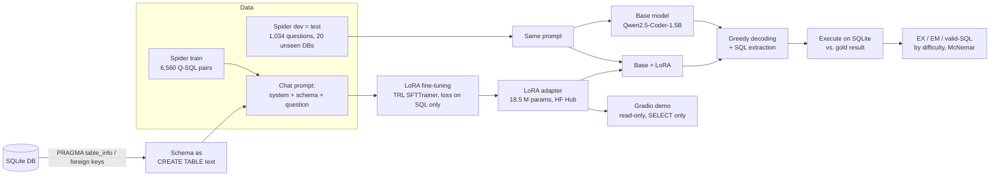
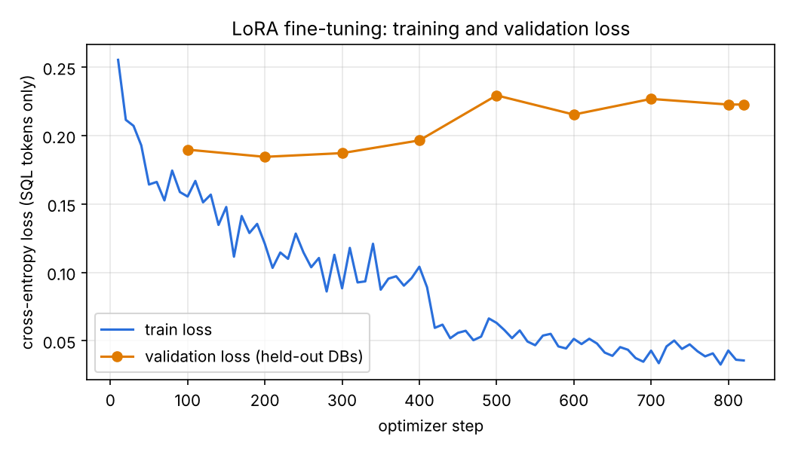
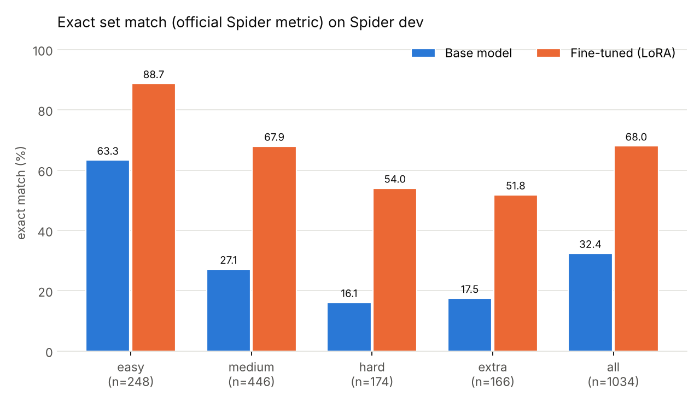
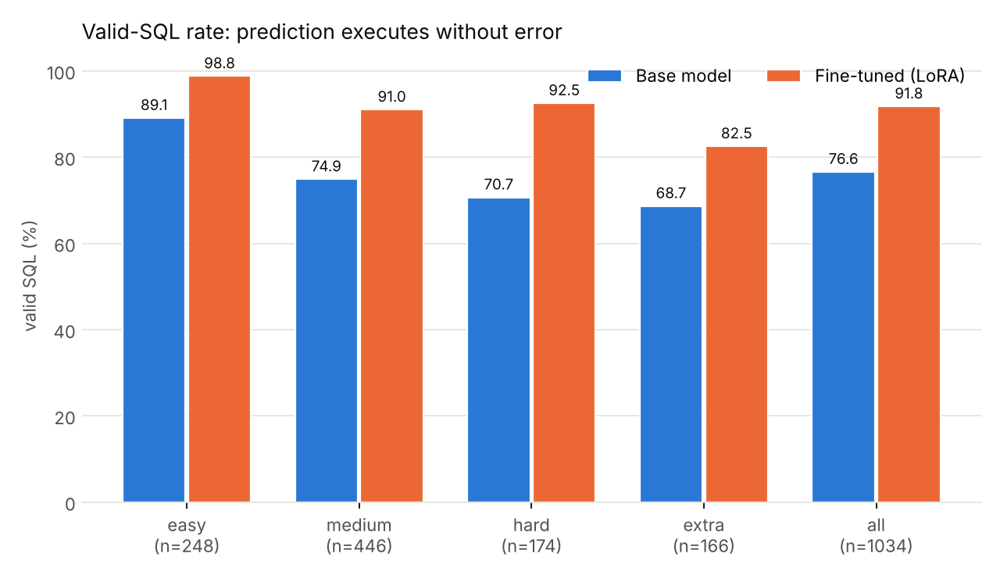
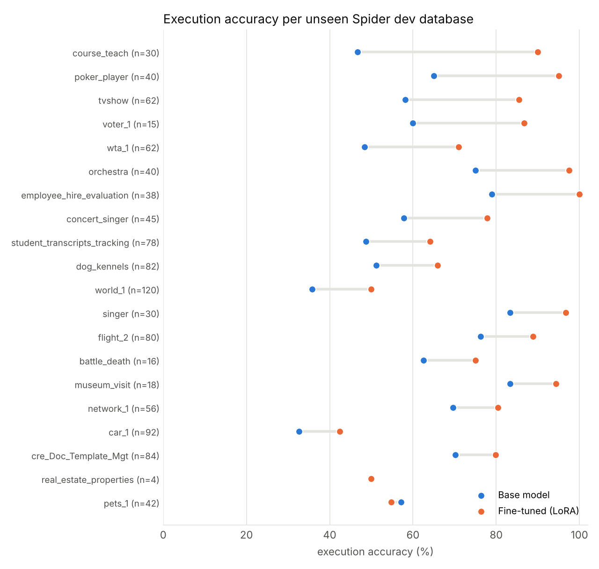
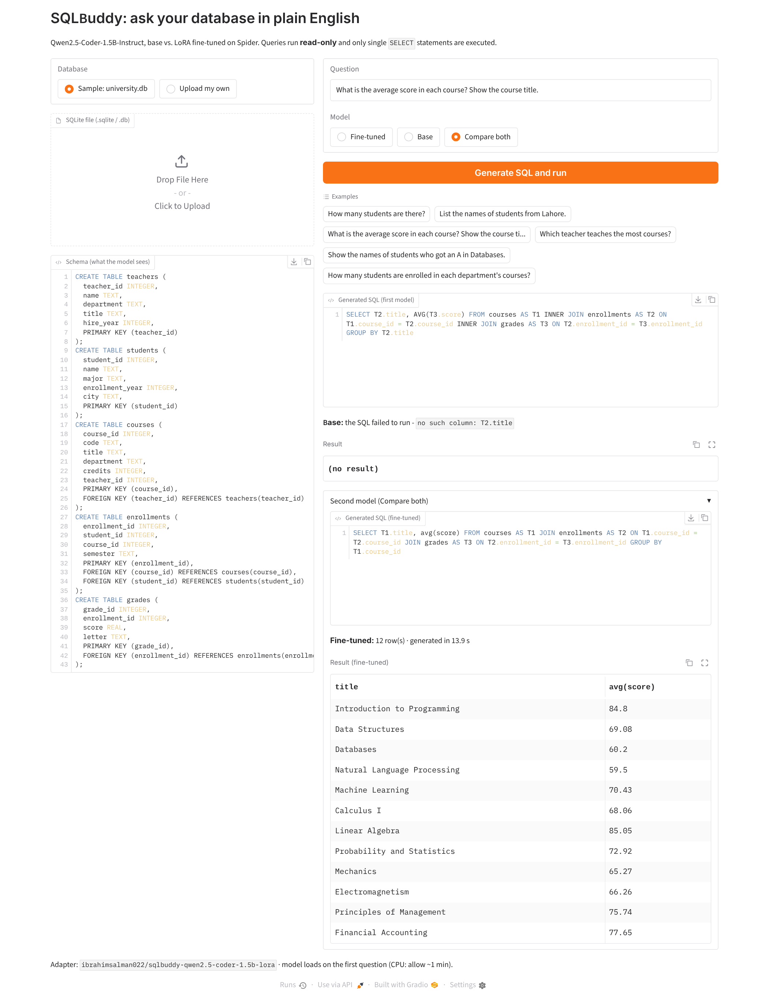

# SQLBuddy: natural-language database querying with a fine-tuned small language model

**SQLBuddy** turns English questions into SQLite queries. We fine-tune
[`Qwen/Qwen2.5-Coder-1.5B-Instruct`](https://huggingface.co/Qwen/Qwen2.5-Coder-1.5B-Instruct) with **LoRA**
on the [Spider](https://yale-lily.github.io/spider) text-to-SQL benchmark. We then test, on **1,034 held-out
questions over 20 databases the model never saw in training**, whether fine-tuning beats the base model.

**Answer: yes.**
- Execution accuracy rises from **57.0 % to 73.1 %** (+16.2 percentage points, 95 % CI [13.2, 19.1]).
- The improvement is highly significant: exact McNemar test, p = 2.4 × 10⁻²⁵.
- Only about **1.2 % of the weights** are trained.



---

## Contents
1. [Problem](#1-problem)
2. [Data](#2-data)
3. [Method](#3-method)
4. [Results](#4-results)
5. [Error analysis](#5-error-analysis-summary)
6. [Limitations](#6-limitations)
7. [Demo on your laptop](#7-run-the-demo-on-your-laptop-windows--macos)
8. [Reproduce the experiments](#8-reproduce-the-experiments-kaggle)
9. [Repository layout](#9-repository-layout)

## 1. Problem

Most people who need data from a database cannot write SQL. Text-to-SQL is a classic NLP task: a semantic
parser maps an utterance to an executable logical form, given the database schema.

Large models such as GPT-4 do this well. But they are expensive and send your schema and data to a third
party. We ask: **can a 1.5 B-parameter model, small enough for a laptop CPU, be made noticeably better at
text-to-SQL with cheap parameter-efficient fine-tuning?** The hypothesis is tested against the base model
on a held-out set.

## 2. Data

| Split | Source | Size | Use |
|---|---|---|---|
| train | Spider `train_spider.json` minus validation DBs (132 DBs) | 6,648 → **6,560** after dropping 88 examples longer than 1,536 tokens | LoRA training |
| validation | 5 % of train, **whole databases** held out (8 DBs, seed 42) | 352 | loss monitoring only |
| **test** | Spider **dev** (20 DBs, none in train) | **1,034** | final evaluation of both models, never trained on |

- Questions and gold SQL come from the HF dataset `xlangai/spider`. The SQLite databases and `tables.json`
  come from the original Spider release (Kaggle mirror).
- Difficulty levels use the official Spider `eval_hardness`:
  - easy: 248 questions.
  - medium: 446.
  - hard: 174.
  - extra hard: 166.
- The validation split holds out whole databases, the same way test DBs are unseen. This keeps the
  validation loss honest about generalisation to new schemas.

## 3. Method



### Prompt

Identical for both models (`src/prompts.py`, `src/schema.py`):
- **System:** *"You are an expert SQLite assistant. Given a database schema and a question, write one SQLite
  SELECT query that answers the question. Return only the SQL query, with no explanation."*
- **User:** the schema, as canonical `CREATE TABLE` statements built from SQLite metadata (columns, types,
  primary and foreign keys), followed by `Question: …`.

### Fine-tuning

`src/train.py` uses PEFT 0.21.2 and TRL 1.17.1 on one Kaggle T4 (16 GB).

| Setting | Value | Why |
|---|---|---|
| LoRA rank / alpha / dropout | 16 / 32 / 0.05 | standard, stable starting point |
| LoRA targets | q, k, v, o, gate, up, down projections | attention + MLP adapt better than attention only |
| trainable parameters | 18.5 M of 1.56 B (1.18 %) | fits a free GPU; adapter file is 74 MB |
| loss | cross-entropy on the **SQL completion only** (prompt masked) | the model should learn to write SQL, not to copy schemas |
| epochs / steps | 2 / 820 | effective batch 16 (4 × 4 gradient accumulation) |
| optimiser | AdamW, lr 2e-4, cosine schedule, 3 % warm-up | |
| precision | fp16 mixed precision (T4 has no bf16), gradient checkpointing | peak memory 5.4 GB |
| max length | 1,536 tokens; longer examples dropped, not truncated | truncation would cut the answer |
| time | 2 h 10 min (9.5 s/step) | |



Training loss falls from 0.26 to 0.04. Validation loss is lowest at step 200 (0.184) and rises in epoch 2
(final 0.223), a sign of over-fitting at token level; see [Limitations](#6-limitations). As fixed in the plan
before testing, the **final** adapter is the one evaluated.

### Evaluation

`src/run_eval.py`, `src/evaluate.py`, with greedy decoding and at most 256 new tokens:
- **Execution accuracy (EX), primary metric.** Run the predicted and gold SQL on the database and compare
  the result rows:
  - Rows are compared as a multiset; order matters only if the gold query has `ORDER BY`.
  - The comparison tolerates column-order differences.
  - Each query has a 30 s timeout.
- **Exact match (EM).** The official Spider exact-set-match: SQL components compared after parsing,
  values ignored. Uses the vendored official `evaluation.py`.
- **Valid-SQL rate.** The prediction executes without error.
- **Significance.** Both models answer the same questions, so the test is paired:
  - exact McNemar test on the questions whose result flipped;
  - paired bootstrap 95 % confidence interval for the difference (10,000 resamples).

## 4. Results

**Spider dev, 1,034 held-out questions** (`results/comparison.csv`):

| Difficulty (n) | EX base | **EX fine-tuned** | Δ EX | EM base | **EM fine-tuned** | valid base | **valid fine-tuned** |
|---|---|---|---|---|---|---|---|
| easy (248)   | 72.2 | **88.3** | +16.1 | 63.3 | **88.7** | 89.1 | **98.8** |
| medium (446) | 59.2 | **74.7** | +15.5 | 27.1 | **67.9** | 74.9 | **91.0** |
| hard (174)   | 39.7 | **63.8** | +24.1 | 16.1 | **54.0** | 70.7 | **92.5** |
| extra (166)  | 46.4 | **56.0** | +9.6  | 17.5 | **51.8** | 68.7 | **82.5** |
| **all (1,034)** | **57.0** | **73.1** | **+16.2** | **32.4** | **68.0** | **76.6** | **91.8** |

**Paired comparison** (`results/statistics.json`, `results/flips.csv`):

| | fine-tuned correct | fine-tuned wrong |
|---|---|---|
| base correct | 536 | 53 |
| base wrong | **220** | 225 |

- Net +167 questions. Exact McNemar p = 2.4 × 10⁻²⁵.
- 95 % CI of the EX gain: **[+13.2, +19.1] pp**.
- The gain is significant at every difficulty level; extra hard is the weakest (+9.6 pp, p = 0.014).

<p>


</p>

Both full evaluations took about 4 minutes of generation on a T4 (batched, 16 prompts at a time).

### Is the gain broad? Per database

18 of the 20 unseen dev databases improve, `real_estate_properties` (4 questions) is unchanged, and `pets_1`
drops by 2.3 points (`results/per_database.csv`). The gain is therefore not carried by one or two easy
databases.



### Does it carry over to a new database? Out-of-domain test

We wrote 30 questions with gold SQL for our own `sample_db/university.db` and fixed them **before** running
either model (`sample_db/university_test.json`, `python -m src.ood_eval`, results in `results/ood/`). The
evaluation used the same prompt, the same decoding and the same execution-accuracy rules, and the official
hardness levels (easy 10, medium 7, hard 7, extra hard 6).

| | base | fine-tuned |
|---|---|---|
| execution accuracy | 36.7 % | **73.3 %** |
| valid SQL | 50.0 % | 80.0 % |
| fixed / broken | | 11 / 0 |

- Exact McNemar test: p = 0.001. 95 % bootstrap CI of the gain: [+20, +53] pp.
- The fine-tuned model keeps its Spider-level accuracy (73.3 vs 73.1). The base model drops (36.7 vs 57.0),
  mainly through the wrong-alias errors described below.
- With 30 questions the interval is wide, so this is supporting evidence, not a main result.
- The questions were written by us, so their style may be closer to Spider than a real user's.

## 5. Error analysis (summary)

The full write-up is [`results/error_analysis.md`](results/error_analysis.md). The 50 hand-labelled
failures are in `results/error_sample.csv`.

- **Fine-tuning mostly fixes *broken* SQL.**
  - 62 % of the 220 fixes were base predictions that did not even execute.
  - The typical base error is a wrong table alias (`no such column: T2.title`): 201 cases, down to 61 after fine-tuning.
- **The model learns Spider's SQL *style*.**
  - It stops using `INNER JOIN` (40 % of base queries, 0 % after).
  - It writes as many JOINs as the gold queries (0.54 vs. 0.50 per query, base 0.65).
  - Its output is always a bare query (the base model added text or fences 13 % of the time).
  - That is why **EM (+35.6 pp) rises much more than EX (+16.2 pp)**: part of the EM gain is learned annotation style.
- **Remaining bottleneck: schema linking.**
  - In the 50 reviewed failures, 27 pick the wrong table, join key or column, or misplace an alias.
  - 6 get nested or set-operation logic wrong.
  - 5 fail because the model never sees cell values: `'French'` vs. stored `'France'`, `'left'` vs. `'L'`.
- **53 regressions.** The fine-tuned model sometimes over-simplifies and drops a join that was needed, for
  example *"Which region is Kabul in?"*. This matches the rising validation loss.
- **Metric caveats.** 2 of 50 "failures" are gold errors or type artefacts. One "fix" is a coincidental
  result match, so EX can also overestimate.

## 6. Limitations

- **One database instance per question.** Execution accuracy can accept a wrong query that happens to
  return the right rows on this one database. Spider's *test-suite accuracy* (several instances per
  question) would be stricter.
- **Possible contamination.** Spider is public, and the base model already writes Spider-style SQL.
  Pre-training may have seen it. This affects both models equally, so the *difference* remains a fair
  estimate of the fine-tuning effect, but absolute numbers may be optimistic.
- **Token-level over-fitting in epoch 2.** Validation loss was best at step 200. Only the final adapter
  was tested, and only the last two checkpoints were kept. Early stopping on validation EX is future work.
- **Scope of the evaluation.**
  - Single run, single seed.
  - No hyper-parameter search.
  - Spider 1.0 only: clean, small schemas. Real enterprise schemas (BIRD, Spider 2.0) are much harder.
- **Schema-only prompt.** The prompt contains no cell values, so value-format errors are unavoidable. Adding
  sample rows is the obvious next step.
- **SQLite only.** Dialect-specific SQL for PostgreSQL or MySQL was not evaluated.

## 7. Run the demo on your laptop (Windows / macOS)



The demo (`app/app.py`, Gradio) works in three steps:
1. **Choose a database.** Pick the sample `university.db` (5 tables, 169 rows, generated by
   `sample_db/make_university_db.py`) or upload your own `.sqlite` file (validated, max 50 MB). A card lists
   the tables with their column and row counts, and the schema the model sees is shown below it.
2. **Ask a question.** Type a question or click an example, then choose **Fine-tuned** (the default),
   **Base** or **Compare both**. Compare runs two generations one after the other, so it takes about twice
   as long.
3. **Read the result.** Each model gets its own panel; in Compare mode the panels sit side by side. Each panel shows:
   - a status badge that moves through *Loading model → Queued → Generating → Running SQL → Done / SQL error / Cancelled*;
   - the SQL as it is generated (streamed);
   - the result table;
   - the device, the mode, the number of tokens and the measured generation time.

SQL errors are explained in plain words. For example, `no such column: T2.title` becomes "the model referred
to a column that does not exist". While a question runs, **Generate** is disabled, so a double click can't
start it twice, and **Stop** ends generation after the current token.

The model loads in the background as soon as the app starts; the status bar shows *Loading model…* and
then *Model ready*.

**Why a question takes several seconds on a laptop:** see [`docs/PERFORMANCE.md`](docs/PERFORMANCE.md).
In short, the CPU runs the whole 1.5 B-parameter network once per generated token, about 0.16 s per
token on 4 cores. Generation itself is not wasteful: it stops at the end of the SQL. The app caches the
schema part of the prompt, which cuts the wait for the first token from about 2.3 s to 0.6 s. On Apple-silicon
Macs it uses the GPU (MPS) automatically.

**Safety.** Queries run on a **read-only** connection, and only a single `SELECT` statement is allowed. Three
further checks apply: a keyword check, an SQLite authorizer that only permits reads, and a 10 s timeout
(results capped at 200 rows).

**Requirements**
- Python 3.11–3.13.
- 8 GB RAM minimum (16 GB recommended; the fp32 model needs about 6 GB) and 4 GB free disk (model download, once).
- No GPU needed: the model runs in fp32 on CPU, and a question takes about 3–15 s.

### Access to the adapter

The adapter lives in a **private** Hugging Face repo, `ibrahimsalman022/sqlbuddy-qwen2.5-coder-1.5b-lora`.
You need a Hugging Face account with access to it (the owner can add group members), plus a *read* token
from https://huggingface.co/settings/tokens. Without access, the app still runs with the base model only.

Alternatively, download the `adapter/` folder from the `sqlbuddy-02-train-lora` Kaggle kernel output and set
`SQLBUDDY_ADAPTER` to that folder.

### Windows (PowerShell)
```powershell
git clone https://github.com/MIbrahimSalman/sqlbuddy.git
cd sqlbuddy
py -3.12 -m venv .venv
.venv\Scripts\Activate.ps1
pip install torch==2.14.1 --index-url https://download.pytorch.org/whl/cpu
pip install -r requirements-demo.txt
hf auth login
python app/app.py
```

### macOS (Terminal)
```bash
git clone https://github.com/MIbrahimSalman/sqlbuddy.git
cd sqlbuddy
python3 -m venv .venv
source .venv/bin/activate
pip install -r requirements-demo.txt
hf auth login
python app/app.py
```

**If `hf auth login` does not work** (e.g. "hf is not recognized" / "command not found"):
- Make sure the virtual environment is active: the prompt starts with `(.venv)`. On Windows, if
  `Activate.ps1` is blocked, run `Set-ExecutionPolicy -Scope CurrentUser RemoteSigned` once, or use
  `cmd` with `.venv\Scripts\activate.bat`.
- Call the login through Python instead (same tool, no PATH needed):
  `python -m huggingface_hub.cli.hf auth login`
- Or skip the login and pass the token for this terminal session only:
  PowerShell `$env:HF_TOKEN="hf_..."`, macOS `export HF_TOKEN=hf_...`, then `python app/app.py`.

### Using the app
1. Open http://127.0.0.1:7860.
2. Click an example question, choose **Compare both** and press **Generate SQL and run**.
   - The first question downloads the model (about 3 GB, once) and loads it (about 1 min).
   - Good comparison questions: *"What is the average score in each course? Show the course title."* and
     *"List the names of students from Lahore."* The base model fails both with an alias error; the
     fine-tuned model answers correctly.
   - *"How many students are enrolled in each department's courses?"* fails with both models. It is an
     honest example of the remaining schema-linking errors.

Other options:
- Local adapter folder instead of HF: `SQLBUDDY_ADAPTER=path/to/adapter python app/app.py`
  (PowerShell: `$env:SQLBUDDY_ADAPTER="path\to\adapter"`).
- Public link: `python app/app.py --share`.

### Backup: GPU demo on Kaggle

Open the Kaggle notebook `sqlbuddy-04-demo`. The adapter comes from the training kernel output, so no HF
token is needed.
1. Choose *GPU T4* and turn *Internet* on.
2. *Run all*.
3. Open the printed `PUBLIC LINK: https://….gradio.live`. It stays up for `DEMO_MINUTES` (90).

## 8. Reproduce the experiments (Kaggle)

All GPU work ran on a free Kaggle T4; every run is logged in [`docs/KAGGLE_RUNS.md`](docs/KAGGLE_RUNS.md).
Requirements:
- Kaggle CLI 2.x with `KAGGLE_USERNAME` and `KAGGLE_API_TOKEN` set.
- For the adapter upload, `HF_TOKEN` with write access.

**0. Local CPU tests** (needs a local Spider copy):
```bash
pip install -r requirements.txt
kaggle datasets download jeromeblanchet/yale-universitys-spider-10-nlp-dataset --unzip -p data
SPIDER_DIR=data/spider python -m pytest -q tests
```

**1. Ship the shared code to Kaggle** as the dataset `<user>/sqlbuddy-src`:
```bash
bash scripts/upload_src.sh "message"
```

**2. Generate the notebooks.** Pass `--smoke 01 02 03 04` for 50-question / 30-step / 1-minute test versions:
```bash
python notebooks/build_notebooks.py
```

**3. Run them in order** (01 baseline, 02 training, 03 fine-tuned eval, 04 demo). For each notebook:
```bash
kaggle kernels push -p notebooks/01_baseline_eval --accelerator NvidiaTeslaT4
```
```bash
kaggle kernels status <user>/sqlbuddy-01-baseline-eval
```
```bash
kaggle kernels output <user>/sqlbuddy-01-baseline-eval -p out/01
```

**4. Upload the adapter**:
```bash
python scripts/upload_adapter.py out/02/train/adapter --train-info out/02/train/train_info.json --loss-png out/02/train/loss_curve.png
```

**5. Compare and analyse** on CPU:
```bash
python -m src.compare results/baseline results/finetuned results
```
```bash
python -m src.analysis results/baseline results/finetuned results/training results
```

Run times on a T4:
- Baseline eval: about 6 min.
- Training: about 2 h 10 min of training time.
- Fine-tuned eval: about 5 min.

Library versions are pinned in the notebooks and in `requirements.txt`:
- transformers 5.22.1, peft 0.21.2, trl 1.17.1;
- accelerate 1.15.0, datasets 5.1.0;
- Kaggle's torch 2.11 with CUDA.

## 9. Repository layout

```
src/                 shared code (all CPU-tested)
  data.py            load Spider (HF questions + SQLite DBs), database-disjoint validation split
  schema.py          SQLite metadata -> CREATE TABLE prompt text
  prompts.py         system prompt, chat messages, gold-SQL normalisation
  sql_extract.py     pull one SQL query out of the model's raw output
  generation.py      load base model (+ LoRA), batched greedy generation
  execution.py       read-only, time-limited SQLite execution
  evaluate.py        EX / EM / valid-SQL scoring by difficulty
  spider_eval/       official Spider evaluation.py + process_sql.py (Apache-2.0)
  run_eval.py        evaluation CLI (notebooks 01 and 03)
  train.py           LoRA fine-tuning CLI (notebook 02)
  compare.py         comparison table, flips, McNemar, bootstrap CI
  analysis.py        charts, automatic error categories, review sample
notebooks/           Kaggle notebooks (generated by build_notebooks.py) + kernel metadata
app/                 Gradio demo (app.py) + back-end with safe execution (sqlbuddy_core.py)
sample_db/           university.db + its generator script
results/             metrics, predictions, comparison, statistics, charts, error analysis
tests/               41 pytest tests (pipeline, statistics, demo safety)
scripts/             upload_src.sh (code -> Kaggle dataset), upload_adapter.py (adapter -> HF)
docs/                PLAN, PROGRESS, DECISIONS (with reasons + alternatives), KAGGLE_RUNS
PRESENTATION_NOTES.md  10-slide outline
```

## Acknowledgements

- Spider: Yu et al., *Spider: A Large-Scale Human-Labeled Dataset for Complex and Cross-Domain Semantic
  Parsing and Text-to-SQL Task*, EMNLP 2018 (CC BY-SA 4.0). The official evaluation scripts are
  Apache-2.0.
- Qwen2.5-Coder: Hui et al., 2024 (Apache-2.0).
- LoRA: Hu et al., ICLR 2022.
